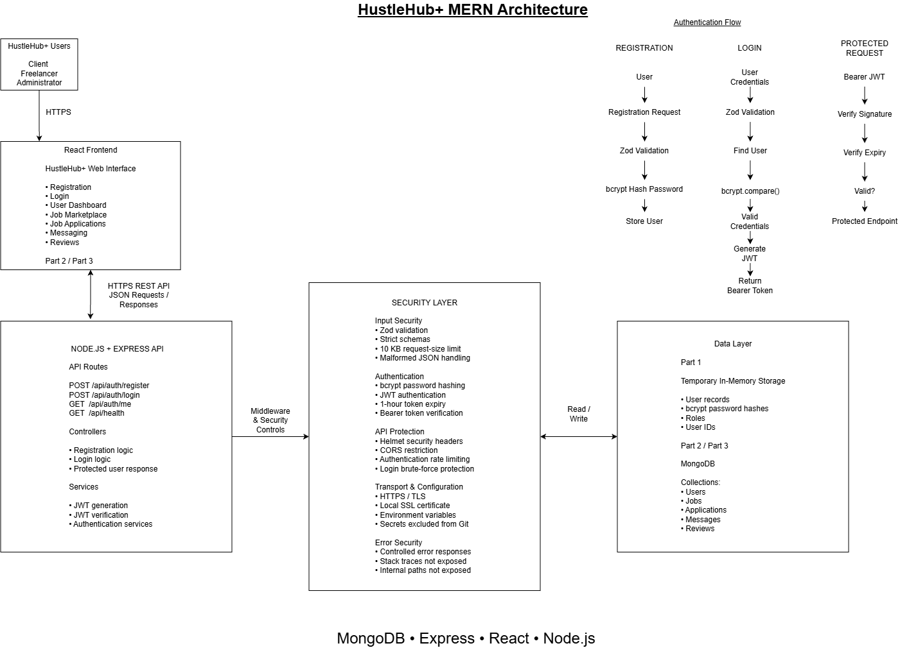
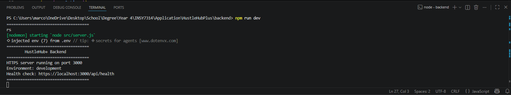
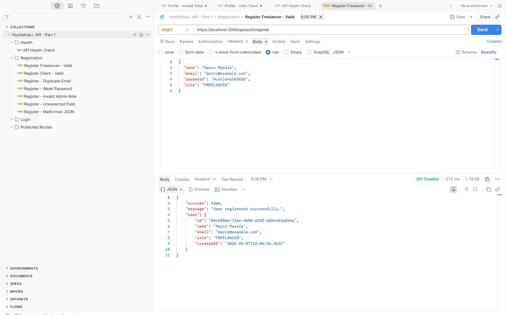
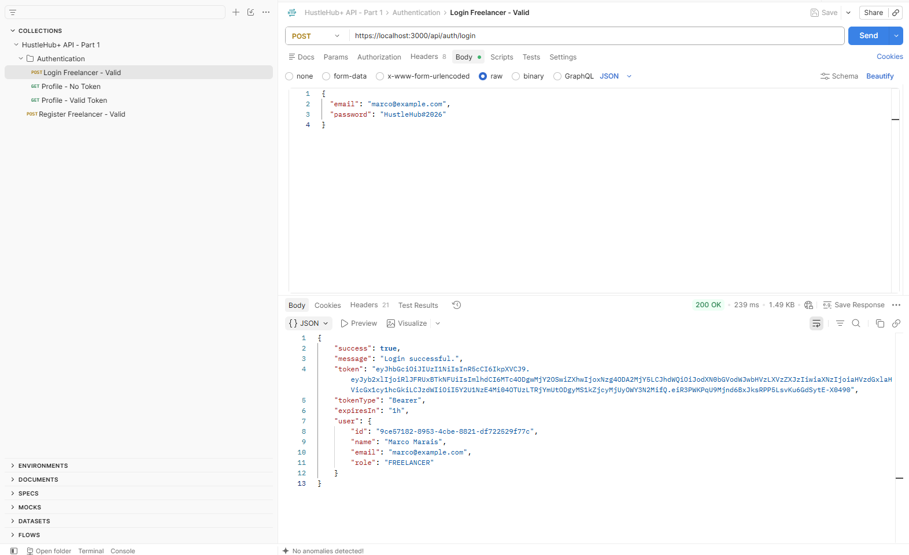
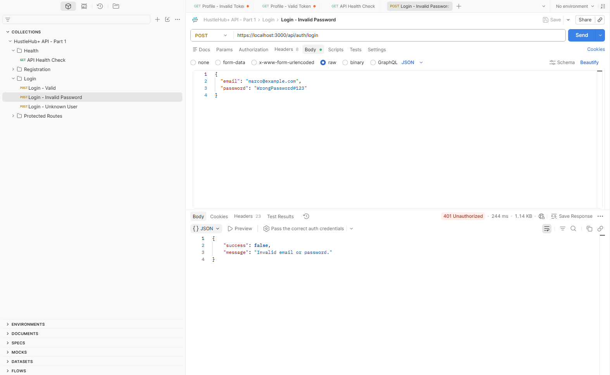
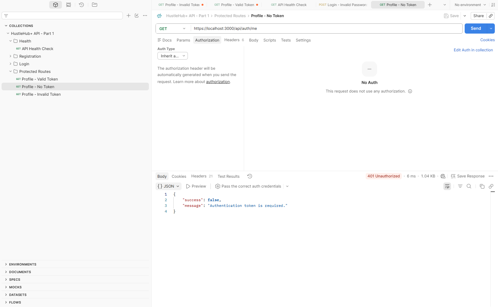
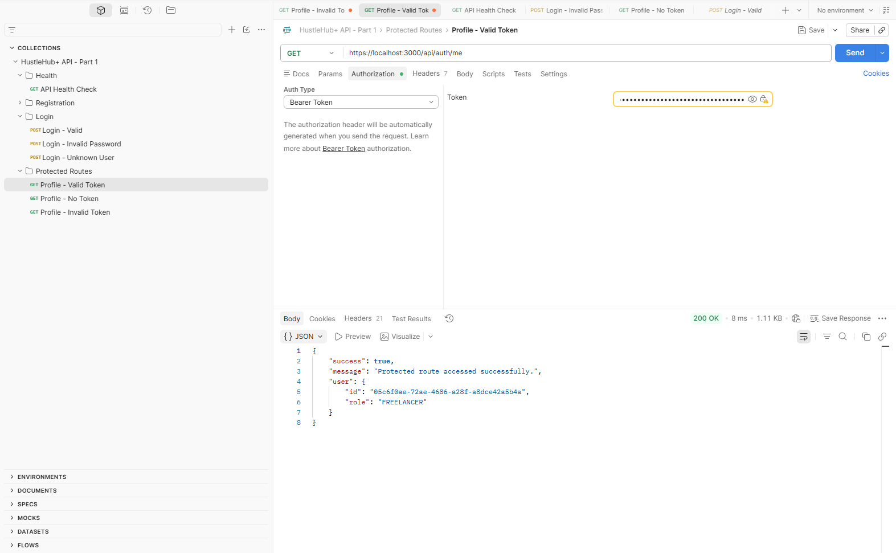
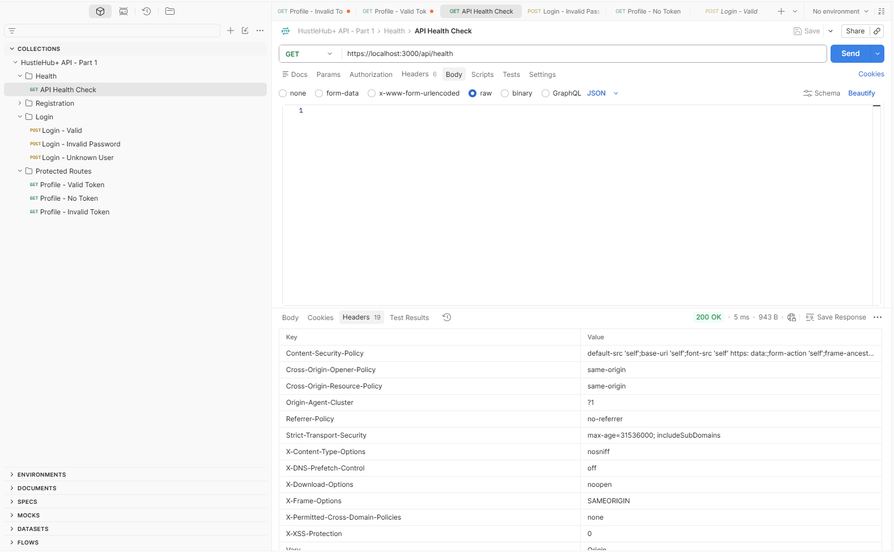

# HustleHub+ – Secure Freelance Marketplace

## INSY7314 POE – Part 1: Secure Foundations

HustleHub+ is a secure web-based freelance marketplace developed as part of the INSY7314 Portfolio of Evidence (POE). The platform is designed to allow freelancers to advertise services and allow clients to browse and book those services.

In addition to standard freelance marketplace functionality, the completed HustleHub+ system will record financial transactions generated through bookings and provide freelancers with information relating to income earned and estimated tax obligations.

The system handles sensitive information such as user credentials, transactional records, and financial information. Security is therefore treated as a core architectural requirement rather than an additional feature.

Part 1 focuses on establishing the secure backend foundation of the system using Node.js and Express.

---

## Part 1 Objectives

The objective of Part 1 is to design and implement a secure REST API that provides the authentication foundation for later stages of HustleHub+.

The Part 1 implementation currently supports:

- Secure user registration.
- Secure user login.
- Password hashing using bcrypt.
- JSON Web Token (JWT) generation.
- JWT validation for protected API routes.
- Role validation for Clients and Freelancers.
- Prevention of public Administrator registration.
- Input validation using Zod.
- Strict request schemas that reject unexpected input.
- Controlled API error responses.
- HTTPS using a locally configured SSL/TLS certificate.
- Security-related HTTP headers using Helmet.
- Cross-Origin Resource Sharing (CORS) restrictions.
- Authentication rate limiting.
- Login brute-force protection.
- Secure storage of environment configuration values.
- Temporary in-memory user storage for Part 1.
- API testing using Postman.

The backend has been structured so that the temporary in-memory storage used in Part 1 can later be replaced with MongoDB as the project progresses.

---

## Intended Users

HustleHub+ is designed around three primary user roles.

### Client

Clients use HustleHub+ to discover and purchase services offered by freelancers.

The completed system is intended to allow Clients to:

- Register and authenticate securely.
- Browse available freelance gigs or services.
- View freelancer information.
- Book services.
- View booking and transaction information.
- Manage their account.

### Freelancer

Freelancers use HustleHub+ to advertise services and manage income generated through the platform.

The completed system is intended to allow Freelancers to:

- Register and authenticate securely.
- Create and manage freelance gigs.
- Receive bookings from Clients.
- View transaction records.
- Track income earned through the platform.
- View estimated tax values.
- Access a financial dashboard.

### Administrator

Administrators are intended to manage and oversee the HustleHub+ platform.

Administrator accounts cannot be created through the public registration endpoint. Public users are restricted to the `CLIENT` and `FREELANCER` roles.

This prevents a malicious user from modifying a registration request and assigning themselves administrative privileges.

Administrator functionality will be expanded during later stages of the POE.

---

## Development Approach

The HustleHub+ POE follows an incremental development approach.

### Part 1 – Secure Backend Foundations

Part 1 establishes:

- Node.js and Express backend architecture.
- Secure registration and login.
- Password hashing.
- JWT authentication.
- Input validation.
- HTTPS.
- API security controls.
- Secure error handling.

### Part 2 – Full-Stack Application Development

The project will be expanded to include:

- React frontend development.
- MongoDB database integration.
- Marketplace functionality.
- Gig management.
- Client bookings.
- Role-based functionality.
- Financial transactions.
- Freelancer income tracking.
- Estimated tax calculations.

### Part 3 – DevSecOps, Monitoring and Finalisation

The final stage will expand the project with:

- Backend and frontend containerisation.
- Automated testing.
- CI/CD.
- Automated API testing.
- Automated security scanning.
- Logging and monitoring.
- Final security hardening.

Each stage builds on and improves the implementation completed during the previous stage.

---

## Technology Stack

HustleHub+ follows the MERN architecture.

| Technology | Purpose |
|---|---|
| MongoDB | Persistent application database planned for later POE stages |
| Express.js | REST API and backend web framework |
| React | Frontend user interface planned for Part 2 |
| Node.js | Backend JavaScript runtime |
| bcryptjs | Secure password hashing |
| JSON Web Token | Token-based user authentication |
| Zod | Request and input validation |
| Helmet | Security-related HTTP response headers |
| CORS | Cross-origin access restrictions |
| express-rate-limit | Rate limiting and brute-force protection |
| dotenv | Environment configuration |
| HTTPS / TLS | Encryption of network communication |
| mkcert | Locally trusted SSL/TLS certificate generation |
| Postman | API testing and test collection |

---

## System Architecture

HustleHub+ is designed according to the MERN architecture consisting of MongoDB, Express, React, and Node.js.

The React frontend communicates with the Node.js and Express backend through an HTTPS REST API using JSON requests and responses.

The Express backend contains routes, controllers, middleware, services, validation logic, and data-access functionality. Security controls are applied throughout the request-processing pipeline before protected application functionality is accessed.

During Part 1, user information is stored in a temporary in-memory data structure as permitted by the assessment requirements. MongoDB will replace this temporary storage mechanism during the later full-stack implementation.

### Architecture Diagram



### Current Part 1 Request Flow

A typical HustleHub+ API request follows the following structure:

```text
Client / Postman
       |
       | HTTPS
       v
Node.js + Express API
       |
       v
Security Middleware
       |
       +--> CORS
       +--> Request Size Restrictions
       +--> Input Validation
       +--> Rate Limiting
       +--> JWT Verification (Protected Routes)
       |
       v
Route
       |
       v
Controller
       |
       v
Service / Application Logic
       |
       v
Temporary In-Memory Data Store
```
This separation of responsibilities improves maintainability and allows individual security controls to be applied consistently throughout the application.

### Backend Project Structure

The backend follows a modular structure to separate routing, business logic, validation, authentication, configuration, and data access.
```text
backend/
│
├── certs/
│   ├── localhost.pem
│   └── localhost-key.pem
│
├── src/
│   ├── config/
│   │   └── securityConfig.js
│   │
│   ├── controllers/
│   │   └── authController.js
│   │
│   ├── data/
│   │   └── userStore.js
│   │
│   ├── middleware/
│   │   ├── authenticateToken.js
│   │   ├── authRateLimiter.js
│   │   ├── errorHandler.js
│   │   └── validateRequest.js
│   │
│   ├── routes/
│   │   └── authRoutes.js
│   │
│   ├── services/
│   │   └── tokenService.js
│   │
│   ├── utils/
│   │
│   ├── validators/
│   │   └── authValidators.js
│   │
│   ├── app.js
│   └── server.js
│
├── .env
├── .env.example
├── .gitignore
├── package-lock.json
└── package.json
```
**config**

Contains security and application configuration.

securityConfig.js currently defines the CORS policy used by the API.

**controllers**

Contains request-handling logic.

**authController.js handles:**

User registration.
User login.
Password verification.
JWT generation.
Responses for protected user requests.

**data**

Contains the Part 1 temporary data store.

userStore.js stores users in memory and provides functions for locating and adding user records.

This storage mechanism is temporary and will be replaced with MongoDB during later POE stages.

**middleware**

Contains functions that execute during the Express request-processing pipeline.

Current middleware includes:
- JWT authentication.
- Request validation.
- Authentication rate limiting.
- Login brute-force protection.
- Controlled 404 handling.
- Global error handling.

**routes**
Defines the available REST API endpoints and connects them to the appropriate middleware and controllers.

**services**
Contains reusable application services.

tokenService.js is responsible for generating and verifying JSON Web Tokens.

**validators**
Contains Zod schemas used to validate incoming request bodies before they reach the controllers.

**app.js**
Configures the Express application, including:

- Helmet.
- CORS.
- Body parsing.
- Request-size restrictions.
- API routes.
- Error-handling middleware.

**server.js**
Creates the HTTPS server, loads the SSL/TLS certificate, and starts the HustleHub+ API.

### Current API Endpoints
The Part 1 API provides the following endpoints:

| Method | Endpoint             | Authentication | Purpose                                           |
| ------ | -------------------- | -------------- | ------------------------------------------------- |
| `GET`  | `/api/health`        | No             | Verify that the HustleHub+ API is running         |
| `POST` | `/api/auth/register` | No             | Register a new Client or Freelancer               |
| `POST` | `/api/auth/login`    | No             | Authenticate a registered user and generate a JWT |
| `GET`  | `/api/auth/me`       | Bearer JWT     | Demonstrate access to a protected endpoint        |

The local development API is served over HTTPS at:
**https://localhost:3000**

---

## Security Design and Decisions

Security is a primary concern in HustleHub+ because the completed platform will process sensitive information including user credentials, authentication tokens, booking records, transaction information, income data, and estimated tax values.

The Part 1 backend therefore implements multiple security controls at different layers of the application rather than relying on a single security mechanism.

The main security controls currently implemented are:

- bcrypt password hashing.
- JSON Web Token authentication.
- JWT expiry and verification.
- Protected API routes.
- Zod input validation.
- Strict request schemas.
- Role restrictions.
- HTTPS/TLS encryption.
- Helmet security headers.
- Restricted CORS configuration.
- Authentication rate limiting.
- Login brute-force protection.
- Request-body size restrictions.
- Controlled error handling.
- Environment-based secret management.
- Prevention of sensitive files being committed to Git.

---

## Password Security

### Password Hashing

HustleHub+ never stores user passwords in plain text.

When a user registers, the supplied password is processed using bcrypt before the user record is stored.

The backend performs the equivalent of:

```javascript
const passwordHash = await bcrypt.hash(password, 12);
```

The resulting bcrypt hash is stored instead of the original password.

A stored user record therefore contains a field such as:

```text
passwordHash
```

rather than:

```text
password
```

The registration API response also excludes both the original password and the resulting password hash.

### Why Passwords Are Hashed

Hashing is a one-way operation. The application does not need to recover the original password when authenticating a user.

Instead, during login, bcrypt compares the password supplied by the user with the stored hash.

```javascript
const passwordMatches = await bcrypt.compare(
  password,
  user.passwordHash
);
```

If the comparison succeeds, authentication may continue.

This approach means that the system does not need to retain recoverable plain-text passwords.

### bcrypt Work Factor

The application currently uses a bcrypt work factor of:

```text
12
```

The work factor increases the computational effort required to generate and test password hashes.

This makes large-scale password guessing more expensive while remaining suitable for the current application.

---

## Password Requirements

Registration passwords must meet minimum complexity requirements.

A password must:

- Contain at least 8 characters.
- Contain no more than 72 characters.
- Include at least one lowercase letter.
- Include at least one uppercase letter.
- Include at least one number.
- Include at least one special character.

For example:

```text
HustleHub#2026
```

would satisfy the current password policy.

A password such as:

```text
password
```

would be rejected.

The purpose of these requirements is to reduce the likelihood of easily guessed passwords being accepted by the system.

---

## JSON Web Token Authentication

HustleHub+ uses JSON Web Tokens (JWTs) to identify authenticated users after a successful login.

The authentication flow is:

```text
User submits email and password
            |
            v
Input is validated
            |
            v
User account is located
            |
            v
bcrypt compares supplied password
with stored password hash
            |
            v
Credentials valid?
       /          \
     No            Yes
     |              |
     v              v
401 response    JWT generated
                    |
                    v
            Token returned to user
```

The JWT is generated only after the user's credentials have been successfully verified.

---

## JWT Contents

The current token contains the information necessary to identify the authenticated user and their role.

The token includes:

- User ID through the JWT subject (`sub`).
- User role.
- Token issuer.
- Token audience.
- Token expiry.

Sensitive information such as the user's password or password hash is not placed inside the token.

The current token configuration uses:

```text
Issuer:   hustlehubplus-api
Audience: hustlehubplus-users
Expiry:   1 hour
```

The signing secret is stored in the local environment configuration rather than being hard-coded into the source code.

---

## JWT Expiration

Authentication tokens expire after:

```text
1 hour
```

The expiry period is configured using:

```env
JWT_EXPIRES_IN=1h
```

Token expiry limits the amount of time that a token remains usable if it is exposed or stolen.

After expiration, the token must no longer provide access to protected routes.

---

## Protected API Routes

Protected routes require a valid JWT using the Bearer authentication scheme.

For example:

```http
Authorization: Bearer <JWT>
```

The current protected route is:

```text
GET /api/auth/me
```

Before the request reaches the controller, authentication middleware performs several checks.

```text
Protected Request
       |
       v
Authorization header present?
       |
       v
Bearer token format valid?
       |
       v
JWT signature valid?
       |
       v
Issuer and audience valid?
       |
       v
Token expired?
       |
       v
Authenticated request permitted
```

If authentication fails, the backend returns:

```text
401 Unauthorized
```

without allowing the request to reach the protected functionality.

---

## Invalid and Expired JWT Handling

Invalid or expired tokens result in a controlled response:

```json
{
  "success": false,
  "message": "Invalid or expired authentication token."
}
```

Detailed JWT library errors are not returned to the client.

This prevents unnecessary internal authentication information from being exposed through API responses.

---

## Authentication Error Messages

When login fails, HustleHub+ deliberately returns the same message for:

- An email address that does not exist.
- An incorrect password for an existing account.

The response is:

```json
{
  "success": false,
  "message": "Invalid email or password."
}
```

The system does not return messages such as:

```text
Email address does not exist.
```

This reduces the amount of information available to an attacker attempting to determine which email addresses have registered accounts.

---

## Input Validation

All registration and login request data is validated before being processed by the relevant controller.

HustleHub+ uses Zod validation schemas for this purpose.

The validation layer checks information such as:

- Required fields.
- Name length.
- Email address format.
- Maximum email length.
- Password length.
- Password complexity.
- Valid user roles.
- Unexpected request properties.

Invalid input is rejected before application logic is executed.

For example, an invalid registration request returns:

```text
400 Bad Request
```

with controlled validation information.

---

## Strict Request Schemas

The registration and login schemas use strict validation.

This means that properties that are not explicitly permitted by the API are rejected.

For example, a malicious request such as:

```json
{
  "name": "Security Test",
  "email": "security@example.com",
  "password": "Security#2026",
  "role": "CLIENT",
  "isAdmin": true
}
```

is not accepted because:

```text
isAdmin
```

is not an approved registration property.

This helps protect the application from unsafe or unexpected client-controlled properties.

---

## Input Normalisation

Where appropriate, incoming data is normalised before processing.

For example:

- Names are trimmed.
- Email addresses are trimmed.
- Email addresses are converted to lowercase.

This helps ensure consistent processing and reduces issues caused by different representations of equivalent values.

For example:

```text
Marco@Example.com
```

and:

```text
marco@example.com
```

are treated consistently when checking for an existing user account.

---

## Role Restrictions

The completed HustleHub+ system is designed for three roles:

```text
CLIENT
FREELANCER
ADMIN
```

However, public registration currently permits only:

```text
CLIENT
FREELANCER
```

The registration validation schema rejects:

```text
ADMIN
```

as a public registration role.

This prevents users from modifying an API request and granting themselves administrative access.

Administrator provisioning will require controlled application logic in a later stage of the system.

---

## Duplicate Account Protection

Before registering a user, the backend checks whether the supplied email address is already associated with an existing account.

If a duplicate account is detected, the API returns:

```text
409 Conflict
```

with the response:

```json
{
  "success": false,
  "message": "An account with this email already exists."
}
```

This prevents multiple Part 1 user records from being created using the same email address.

---

## HTTPS and TLS

The HustleHub+ backend is served using HTTPS rather than plain HTTP.

The local development API is available at:

```text
https://localhost:3000
```

A locally trusted SSL/TLS certificate is generated using `mkcert`.

The certificate and private key are loaded by the Node.js HTTPS server when the application starts.

HTTPS provides encrypted communication between the API client and the server.

This is particularly important during authentication because registration and login requests contain sensitive information such as user credentials.

Without HTTPS, sensitive information transmitted over an untrusted network may be vulnerable to interception.

The combination of password hashing and HTTPS protects credentials at different stages:

```text
Password being transmitted
          |
          v
      HTTPS / TLS
          |
          v
Encrypted in transit


Password received by server
          |
          v
       bcrypt
          |
          v
Hashed before storage
```

Therefore:

- HTTPS protects credentials while they are transmitted.
- bcrypt protects passwords when they are stored.

---

## Local SSL Certificate Security

The SSL certificate files are stored locally inside:

```text
backend/certs/
```

The certificate private key is not intended to be committed to GitHub.

The project's `.gitignore` therefore excludes:

```text
certs/
*.key
*.pem
*.crt
```

A developer cloning the repository must generate their own local certificate rather than relying on a private key committed to source control.

---

## Helmet Security Headers

HustleHub+ uses Helmet middleware to apply security-related HTTP response headers.

Helmet is configured in the Express application using:

```javascript
app.use(helmet());
```

Depending on the installed Helmet version and request context, these headers can include protections relating to:

- Content type handling.
- Framing.
- Referrer behaviour.
- Cross-origin resource policies.
- Transport security.
- Browser security behaviour.

Helmet provides an additional defensive layer for HTTP responses.

---

## Technology Disclosure Reduction

Express may normally include the following response header:

```text
X-Powered-By: Express
```

HustleHub+ disables this using:

```javascript
app.disable("x-powered-by");
```

The application therefore avoids unnecessarily advertising the backend framework through this header.

This control does not replace other security mechanisms but reduces unnecessary technology disclosure.

---

## Cross-Origin Resource Sharing (CORS)

The API uses a controlled CORS configuration rather than permitting unrestricted browser origins.

The intended React development frontend is configured as:

```text
https://localhost:5173
```

The allowed origin is stored using the environment variable:

```env
CLIENT_ORIGIN=https://localhost:5173
```

Requests originating from other browser origins are rejected by the CORS policy.

Requests from development tools such as Postman that do not include a browser Origin header are permitted for API testing.

The CORS configuration also restricts the accepted request headers to those required by the application, including:

```text
Content-Type
Authorization
```

---

## Rate Limiting

HustleHub+ uses `express-rate-limit` to reduce abuse of authentication endpoints.

General authentication requests are currently limited to:

```text
30 requests per 15 minutes
```

A stricter login-specific limiter allows:

```text
10 failed login attempts per 15 minutes
```

Successful login attempts are excluded from the stricter failed-login count.

Rate limiting helps reduce the effectiveness of automated brute-force and high-volume authentication attacks.

---

## Request-Body Size Restrictions

JSON and URL-encoded request bodies are currently restricted to:

```text
10 KB
```

For example:

```javascript
express.json({
  limit: "10kb",
  strict: true
});
```

Authentication requests require only a small amount of information.

There is therefore no legitimate reason for registration or login requests to contain extremely large request bodies.

Oversized requests are rejected using:

```text
413 Payload Too Large
```

with a controlled API response.

---

## Malformed JSON Handling

Malformed JSON requests are handled by the application's global error middleware.

For example, the following request is invalid:

```json
{
  "email": "user@example.com",
  "password":
}
```

Instead of exposing an internal Express parsing error, HustleHub+ returns:

```json
{
  "success": false,
  "message": "Invalid JSON request body."
}
```

with:

```text
400 Bad Request
```

---

## Secure Error Handling

API errors are handled through centralised Express middleware.

The application avoids returning sensitive internal information such as:

- Stack traces.
- Absolute server file paths.
- Source code locations.
- JWT secrets.
- Environment configuration values.
- Internal JavaScript error objects.

For unexpected server errors, the client receives a generic response such as:

```json
{
  "success": false,
  "message": "An unexpected server error occurred."
}
```

Unknown API routes also return a controlled JSON response:

```json
{
  "success": false,
  "message": "The requested resource was not found."
}
```

This is preferable to returning implementation-specific error information.

---

## Environment Variables and Secret Management

Sensitive configuration is stored using environment variables.

The local `.env` file contains configuration such as:

```text
PORT
NODE_ENV
JWT_SECRET
JWT_EXPIRES_IN
SSL_KEY_PATH
SSL_CERT_PATH
CLIENT_ORIGIN
```

The real `.env` file is excluded from Git using:

```gitignore
.env
```

The repository instead contains:

```text
.env.example
```

which documents the required environment variables without containing the real JWT signing secret.

A secure random JWT secret can be generated using Node.js:

```powershell
node -e "console.log(require('crypto').randomBytes(64).toString('hex'))"
```

The generated secret should be placed only in the local `.env` file.

---

## Source Control Security

The `.gitignore` file prevents sensitive or unnecessary development files from being included in the Git repository.

Examples include:

```gitignore
node_modules/
.env
certs/
*.key
*.pem
*.crt
*.log
coverage/
```

This prevents:

- JWT secrets from being committed.
- SSL private keys from being committed.
- Local dependency files from unnecessarily being stored in Git.
- Local log and coverage output from cluttering the repository.

---

## Defence-in-Depth Approach

HustleHub+ does not depend on a single security mechanism.

Instead, multiple controls are applied at different stages of a request.

```text
Incoming Request
       |
       v
HTTPS / TLS
       |
       v
CORS Policy
       |
       v
Request Size Restriction
       |
       v
Rate Limiting
       |
       v
Input Validation
       |
       v
JWT Authentication
(if route is protected)
       |
       v
Controller / Application Logic
       |
       v
Secure Data Handling
       |
       v
Controlled Response
```

This defence-in-depth approach means that failure or bypass of one control does not automatically remove every other security protection in the system.

---

## Summary of Security Controls

| Security Concern | HustleHub+ Control |
|---|---|
| Plain-text password storage | bcrypt hashing |
| Weak registration passwords | Password complexity validation |
| Authentication | JWT |
| Long-lived authentication tokens | One-hour token expiry |
| Unauthenticated protected access | JWT middleware |
| Forged/invalid tokens | JWT signature validation |
| Expired tokens | JWT expiry validation |
| Public Administrator creation | Role restriction |
| Unexpected request properties | Strict Zod schemas |
| Invalid user input | Zod validation |
| Inconsistent email input | Normalisation to lowercase |
| Credential interception | HTTPS/TLS |
| Security-related HTTP headers | Helmet |
| Unrestricted browser origins | CORS allow-list |
| Authentication abuse | Rate limiting |
| Brute-force login attempts | Login-specific rate limiting |
| Oversized request bodies | 10 KB body limit |
| Malformed JSON | Controlled `400` response |
| Error information leakage | Centralised controlled errors |
| Framework disclosure | `X-Powered-By` disabled |
| Hard-coded JWT secret | Environment variable |
| Secret exposure through Git | `.gitignore` |
| SSL private-key exposure | Certificate files excluded from Git |

---

## Installation and Setup

### Prerequisites

The following software is required to run the Part 1 HustleHub+ backend locally:

- Node.js.
- npm.
- Git.
- Postman.
- mkcert.
- A modern web browser.
- Visual Studio Code or another suitable code editor.

---

## Clone the Repository

Clone the project repository using Git:

```powershell
git clone <YOUR-GITHUB-REPOSITORY-URL>
```

Navigate into the project:

```powershell
cd HustleHubPlus
```

Then enter the backend directory:

```powershell
cd backend
```

---

## Install Backend Dependencies

Run:

```powershell
npm install
```

This installs the dependencies defined inside `package.json`.

The primary Part 1 dependencies include:

```text
express
bcryptjs
jsonwebtoken
zod
dotenv
helmet
cors
express-rate-limit
```

Nodemon is installed as a development dependency.

---

## Configure Environment Variables

Create a local:

```text
.env
```

file inside the `backend` directory.

The repository contains:

```text
.env.example
```

as a template.

The local configuration should contain:

```env
PORT=3000
NODE_ENV=development

JWT_SECRET=YOUR_SECURE_RANDOM_SECRET
JWT_EXPIRES_IN=1h

SSL_KEY_PATH=certs/localhost-key.pem
SSL_CERT_PATH=certs/localhost.pem

CLIENT_ORIGIN=https://localhost:5173
```

Do not use the placeholder JWT secret in a real environment.

Generate a secure local secret using:

```powershell
node -e "console.log(require('crypto').randomBytes(64).toString('hex'))"
```

Copy the generated value into:

```env
JWT_SECRET=
```

The `.env` file must not be committed to source control.

---

## Configure Local HTTPS

HustleHub+ requires HTTPS.

### Install mkcert

If mkcert is not already available on Windows, it can be installed using:

```powershell
winget install FiloSottile.mkcert
```

After installation, open a new terminal.

Verify the installation using:

```powershell
mkcert -version
```

### Install the Local Certificate Authority

Run:

```powershell
mkcert -install
```

This installs a locally trusted certificate authority for development.

### Create the Certificate Directory

From the `backend` directory:

```powershell
mkdir certs
cd certs
```

### Generate the Certificate

Run:

```powershell
mkcert localhost 127.0.0.1 ::1
```

mkcert will create a certificate and corresponding private key.

Rename the generated files to:

```text
localhost.pem
localhost-key.pem
```

The resulting structure should be:

```text
backend/
└── certs/
    ├── localhost.pem
    └── localhost-key.pem
```

Return to the backend directory:

```powershell
cd ..
```

Certificate files are intentionally excluded from Git and therefore must be generated locally after cloning the repository.

---

## Start the Backend

Start the development server using:

```powershell
npm run dev
```

A successful startup should display output similar to:

```text
====================================
        HustleHub+ Backend
====================================
HTTPS server running on port 3000
Environment: development
Health check: https://localhost:3000/api/health
====================================
```

---

## Verify the API

Open:

```text
https://localhost:3000/api/health
```

A successful response should be:

```json
{
  "success": true,
  "message": "HustleHub+ API is running"
}
```

The HustleHub+ Part 1 backend is now ready for API testing.

---

## Development Scripts

The backend currently provides the following npm scripts:

| Command | Purpose |
|---|---|
| `npm run dev` | Starts the backend using Nodemon |
| `npm start` | Starts the backend using Node.js |
| `npm test` | Reserved for automated testing development |

To stop the development server, press:

```text
Ctrl + C
```

in the terminal where the application is running.

---

## Part 1 Data Storage

Part 1 uses an in-memory JavaScript data structure for user records.

This approach is permitted for the secure backend foundation stage of the POE and allows the authentication system to be developed independently of the final database implementation.

An important consequence is that user records exist only while the Node.js process is running.

When the backend is restarted:

```text
All Part 1 in-memory users are cleared.
```

A user must therefore be registered again before login testing can continue after a restart.

This behaviour is expected during Part 1 and is not intended for production use.

During Part 2, the temporary data layer will be replaced with MongoDB to provide persistent data storage while retaining the existing routes, controllers, authentication middleware, validation, and security architecture.

---

## API Testing with Postman

Postman is used to verify the behaviour and security controls of the HustleHub+ Part 1 REST API.

A Postman collection is included with the submission and contains tests for successful requests as well as invalid and unauthorised scenarios.

All requests are executed over:

```text
https://localhost:3000
```

### Postman Collection Structure

```text
HustleHub+ API - Part 1
│
├── Health
│   └── API Health Check
│
├── Registration
│   ├── Register Freelancer - Valid
│   ├── Register Client - Valid
│   ├── Register - Duplicate Email
│   ├── Register - Weak Password
│   ├── Register - Invalid Admin Role
│   ├── Register - Unexpected Field
│   └── Register - Malformed JSON
│
├── Login
│   ├── Login - Valid
│   ├── Login - Invalid Password
│   └── Login - Unknown User
│
└── Protected Routes
    ├── Profile - Valid Token
    ├── Profile - No Token
    └── Profile - Invalid Token
```

---

## Postman Test Cases

| Test | Method | Endpoint | Expected Result |
|---|---|---|---|
| API health check | `GET` | `/api/health` | `200 OK` |
| Valid Freelancer registration | `POST` | `/api/auth/register` | `201 Created` |
| Valid Client registration | `POST` | `/api/auth/register` | `201 Created` |
| Duplicate registration | `POST` | `/api/auth/register` | `409 Conflict` |
| Weak password | `POST` | `/api/auth/register` | `400 Bad Request` |
| Invalid Administrator registration | `POST` | `/api/auth/register` | `400 Bad Request` |
| Unexpected request property | `POST` | `/api/auth/register` | `400 Bad Request` |
| Malformed JSON | `POST` | `/api/auth/register` | `400 Bad Request` |
| Valid login | `POST` | `/api/auth/login` | `200 OK` and JWT |
| Incorrect password | `POST` | `/api/auth/login` | `401 Unauthorized` |
| Unknown user | `POST` | `/api/auth/login` | `401 Unauthorized` |
| Protected route without JWT | `GET` | `/api/auth/me` | `401 Unauthorized` |
| Protected route with invalid JWT | `GET` | `/api/auth/me` | `401 Unauthorized` |
| Protected route with valid JWT | `GET` | `/api/auth/me` | `200 OK` |
| Unknown API endpoint | `GET` | Invalid route | `404 Not Found` |

---

## Example Registration Request

### Request

```http
POST /api/auth/register
Content-Type: application/json
```

```json
{
  "name": "Test Freelancer",
  "email": "freelancer@example.com",
  "password": "HustleHub#2026",
  "role": "FREELANCER"
}
```

### Successful Response

```json
{
  "success": true,
  "message": "User registered successfully.",
  "user": {
    "id": "<generated-user-id>",
    "name": "Test Freelancer",
    "email": "freelancer@example.com",
    "role": "FREELANCER",
    "createdAt": "<generated-timestamp>"
  }
}
```

The API does not return the user's password or password hash.

---

## Example Login Request

### Request

```http
POST /api/auth/login
Content-Type: application/json
```

```json
{
  "email": "freelancer@example.com",
  "password": "HustleHub#2026"
}
```

### Successful Response

A successful login returns:

```text
200 OK
```

and includes a signed JWT:

```json
{
  "success": true,
  "message": "Login successful.",
  "token": "<JWT>",
  "tokenType": "Bearer",
  "expiresIn": "1h",
  "user": {
    "id": "<user-id>",
    "name": "Test Freelancer",
    "email": "freelancer@example.com",
    "role": "FREELANCER"
  }
}
```

---

## Example Protected Request

The protected profile endpoint requires:

```http
Authorization: Bearer <JWT>
```

Request:

```http
GET /api/auth/me
```

A valid token returns:

```text
200 OK
```

An absent, invalid, or expired token returns:

```text
401 Unauthorized
```

This demonstrates that protected API routes cannot be accessed without successful authentication.

---

## Postman Collection

The exported Postman collection used to test the Part 1 API is included in the repository:

```text
postman/HustleHubPlus-Part1.postman_collection.json
```

The collection can be imported into Postman using the application's import functionality.

The collection uses the following collection variables:
| Variable  | Purpose                                            |
| --------- | -------------------------------------------------- |
| `baseUrl` | Base URL of the local HustleHub+ HTTPS API         |
| `token`   | JWT generated dynamically after a successful login |

The token variable is intentionally exported without a live JWT value. The valid login request stores a newly generated JWT at runtime for use by authenticated requests.

## API Response Screenshots

The following screenshots provide evidence of the Part 1 HustleHub+ backend functionality and security controls.

### HTTPS Backend

The HustleHub+ Node.js and Express API is served locally over HTTPS.



---

### Successful User Registration

A valid Freelancer registration request returns `201 Created`.



---

### Successful Login and JWT Generation

Valid credentials result in successful authentication and generation of a JSON Web Token.



---

### Invalid Login

Invalid credentials are rejected using a controlled `401 Unauthorized` response.



---

### Protected Route Without Authentication

A request to a protected endpoint without a JWT is rejected.



---

### Protected Route With Valid JWT

A valid Bearer JWT allows the authenticated user to access the protected endpoint.



---

### Security Response Headers

Helmet adds security-related HTTP response headers to the HustleHub+ API.

The Express `X-Powered-By` header is also disabled to reduce unnecessary technology disclosure.



---

## Demonstration Video

A demonstration video showing the HustleHub+ Part 1 backend, secure user registration, login with JWT generation, input validation and protected API route authentication is available at:

**Video Link:** [HustleHub+ Part 1 Demonstration](https://youtu.be/7Yml1_xBfC4)

## Part 2 MongoDB Integration

Part 2 replaces the temporary in-memory user storage used during Part 1 with persistent MongoDB storage through Mongoose.

User records are now stored in the `users` collection and contain the user's name, normalised email address, bcrypt password hash, role, and timestamps.

Plain-text passwords are never stored in MongoDB. The `passwordHash` field is configured with `select: false`, preventing it from being included in normal queries unless authentication logic explicitly requests it.

MongoDB persistence also means registered user accounts remain available after the Node.js backend is restarted.

## Role-Based Access Control

Part 2 extends the JWT authentication implemented during Part 1 with Role-Based Access Control (RBAC).

HustleHub+ currently recognises the following roles:

- `CLIENT`
- `FREELANCER`
- `ADMIN`

JWT authentication establishes the identity of the requester, while RBAC determines whether that authenticated user is permitted to perform the requested operation.

The backend uses reusable `authorizeRoles()` middleware. This ensures that role restrictions are enforced server-side rather than relying only on frontend visibility.

For example, freelancer-only functionality uses:

```javascript
authenticateToken,
authorizeRoles(ROLES.FREELANCER)
```
## Gig Management

Part 2 introduces persistent marketplace Gig functionality using MongoDB.

Freelancers can:

- Create Gigs.
- View their own Gigs.
- Update their own Gigs.
- Delete their own Gigs.
- Activate or deactivate listings.

Active Gigs can be browsed through the marketplace.

### Gig Ownership

Each Gig stores a MongoDB reference to the Freelancer who created it.

Gig management operations use both Role-Based Access Control and ownership verification.

A valid `FREELANCER` role alone does not permit modification of another Freelancer's Gig. Before update or delete operations are performed, HustleHub+ compares the authenticated user's MongoDB ID with the Gig's stored Freelancer ID.

An ownership mismatch returns:

```text
403 Forbidden
```
## Booking Management

Part 2 allows authenticated Clients to create bookings for active marketplace Gigs.

Booking creation is restricted to the `CLIENT` role using server-side Role-Based Access Control.

### Secure Booking Creation

Clients supply only the selected Gig identifier and optional service requirements.

Sensitive booking information is not trusted from client-controlled input.

The backend retrieves the selected Gig from MongoDB and derives:

- The Freelancer from the Gig owner.
- The booking amount from the Gig price.
- The Gig title from the stored Gig.
- The Client from the authenticated JWT user.

This prevents a Client from manipulating the booking price or assigning the booking to an arbitrary Freelancer.

Unexpected properties such as `amount`, `freelancer`, `status`, and `paymentStatus` are rejected by the strict Zod validation schema.

### Simulated Payment

Part 2 does not process real payment-card information.

Successful bookings currently use a simulated confirmation state:

```text
Booking status: CONFIRMED
Payment status: SIMULATED_CONFIRMED
```

No card number, CVV, bank-account information, or other payment credentials are collected.

### Booking Access Control

Clients may view only their own bookings.

Freelancers may view bookings made for Gigs they own.

Individual booking access is also protected at resource level. Only the Client or Freelancer participating in a Booking may retrieve it.

An unrelated authenticated user receives:

```text
403 Forbidden
```

### Booking Rate Limiting

Booking creation is protected by a dedicated rate limiter to reduce automated abuse of the booking endpoint.

## Transactions and Freelancer Income

Every successful Part 2 booking now automatically creates a corresponding financial Transaction.

Booking creation and Transaction creation are performed inside the same MongoDB transaction. This ensures that the two records are committed together.

If either database operation fails, the complete operation is rolled back.

This prevents inconsistent states such as:

```text
Booking exists but financial Transaction is missing
```

### Transaction Data

Financial Transactions contain:

- A unique transaction reference.
- Booking reference.
- Gig reference.
- Client reference.
- Freelancer reference.
- Gig title.
- Confirmed amount.
- Currency.
- Transaction type.
- Transaction status.
- Simulated payment method.
- Creation and update timestamps.

The amount, Client, Freelancer and Gig are derived from trusted server-side and database information rather than user-controlled transaction input.

### Simulated Payment Records

HustleHub+ does not collect or process real card or banking information.

Successful bookings generate:

```text
type: BOOKING_PAYMENT
status: COMPLETED
paymentMethod: SIMULATED
currency: ZAR
```

### Freelancer Income

Freelancer income is calculated from completed `BOOKING_PAYMENT` Transactions belonging to the authenticated Freelancer.

The income endpoint returns the total completed income and number of completed transactions.

Clients cannot access Freelancer income summaries.

### Financial Access Control

Clients can view their own transaction history.

Freelancers can view Transactions generated from their own Gigs.

An individual Transaction may only be accessed by the Client or Freelancer participating in that Transaction.

Unrelated authenticated users receive `403 Forbidden`.

## Part 2 Security Hardening

Part 2 expands the security controls introduced during Part 1 to protect the full marketplace and MongoDB-backed application.

### Input Sanitisation

User-controlled display text such as names, Gig titles, descriptions, categories and Booking requirements is converted to plain text before storage.

HTML tags and attributes are removed because HustleHub+ does not require users to submit executable HTML content.

Passwords are not sanitised or modified before hashing because altering password input would change the user's credential.

### NoSQL Injection Defence

HustleHub+ rejects request object keys associated with MongoDB operators or unsafe object structures, including keys beginning with `$`, dotted keys, and prototype-related properties.

The application also avoids passing complete request bodies directly into MongoDB queries.

Queries are constructed using explicitly selected and validated fields.

Strict Zod schemas provide an additional defensive layer by rejecting unexpected input structures.

### Mass Assignment Protection

Sensitive properties are derived server-side and cannot be directly controlled by API users.

Examples include:

- Gig ownership.
- Booking Client.
- Booking Freelancer.
- Booking amount.
- Booking status.
- Payment status.
- Transaction parties.
- Transaction amount.
- Transaction status.

### Content Security Policy

Helmet applies a restrictive Content Security Policy to the JSON backend API.

Because the API does not render browser content, it uses a restrictive `default-src 'none'` policy together with protections against framing, forms, objects and unwanted base URI behaviour.

The React frontend will use a separate frontend-appropriate CSP.

### Content-Type Enforcement

API requests using `POST`, `PUT` or `PATCH` must use:

```text
Content-Type: application/json
```

Unsupported write-request content types are rejected with:

```text
415 Unsupported Media Type
```

### Rate Limiting

Part 2 uses layered rate limiting:

- General API request limiting.
- Authentication request limiting.
- Stricter failed-login limiting.
- Booking creation limiting.

This reduces automated abuse and brute-force activity.

### Sensitive Response Caching

Authentication, Booking and financial Transaction routes return cache-control headers that prevent sensitive responses from being stored by normal HTTP caches.

### Defence in Depth

A typical protected Part 2 request passes through multiple controls:

```text
HTTPS
→ Helmet / CSP
→ CORS
→ Rate Limiting
→ Content-Type Validation
→ Request Size Limit
→ Unsafe MongoDB Key Detection
→ Zod Validation / Sanitisation
→ JWT Authentication
→ Current MongoDB User Lookup
→ Role-Based Access Control
→ Resource Ownership
→ Controller
→ Mongoose
→ MongoDB
→ Controlled Response
```

No single mechanism is relied upon as the application's only security control.

## React Frontend

Part 2 introduces the React frontend for HustleHub+ using Vite.

The frontend is served locally over HTTPS at:

```text
https://localhost:5173
```

## Frontend Authentication

Part 2 connects the React frontend to the MongoDB-backed authentication API.

Users can register as either:

- `CLIENT`
- `FREELANCER`

Administrator registration remains unavailable through the public interface.

### Login

Successful login returns a signed JWT from the Express API.

The frontend stores the active token in browser `sessionStorage` under:

```text
hustlehub_token
```

The token is removed when the user explicitly logs out and is naturally scoped to the browser session.

Passwords, password hashes, database credentials and JWT signing secrets are never stored by the React application.

### Session Restoration

When the React application reloads and a JWT exists, the frontend calls:

```text
GET /api/auth/me
```

The backend verifies the token and retrieves the current MongoDB user.

This avoids relying solely on user or role information cached by the browser.

### Protected Frontend Routes

React includes protected routes for authenticated users and separate role-specific routes for Clients and Freelancers.

For example:

```text
/client/dashboard
```

requires the `CLIENT` role, while:

```text
/freelancer/dashboard
```

requires the `FREELANCER` role.

Frontend route protection improves navigation and user experience but is not treated as the security boundary. The Express API independently enforces JWT authentication, Role-Based Access Control and resource ownership for every protected backend operation.

### Client-Side Validation

Registration and login forms provide immediate client-side validation for usability.

However, all requests are independently validated by the Express backend because browser-side validation can be bypassed.

### JWT Storage Trade-Off

Part 2 uses `sessionStorage` to integrate with the existing Bearer-token authentication architecture.

Unlike `localStorage`, the token does not persist indefinitely across browser sessions. However, `sessionStorage` remains accessible to JavaScript and therefore depends on strong XSS controls.

HustleHub+ reduces this risk using backend HTML sanitisation, React's normal JSX output escaping, a restrictive security design, and by avoiding `dangerouslySetInnerHTML` for user-controlled content.

## Marketplace Frontend

The React frontend retrieves active Gig data from the Express API and displays it through the HustleHub+ Marketplace.

Marketplace data is loaded using:

```text
GET /api/gigs
```

Individual active Gigs are retrieved using:

```text
GET /api/gigs/:id
```

The Marketplace supports:

- Active Gig cards.
- Freelancer display information.
- ZAR price formatting.
- Delivery-time display.
- Search by Gig title, description, category and Freelancer.
- Category filtering.
- Loading states.
- Controlled API error states.
- Empty marketplace handling.
- Individual Gig detail pages.
- Role-aware booking prompts.

Only Gigs marked as active by the backend appear in the public Marketplace.

### Marketplace Security

The React application does not determine whether a Gig is publicly available. The Express API independently restricts public marketplace queries to active Gigs.

User-controlled Gig content is rendered through normal React JSX output and `dangerouslySetInnerHTML` is not used.

This complements the backend plain-text sanitisation introduced during Part 2 security hardening.

## Freelancer Gig Management

Authenticated Freelancers can manage their marketplace catalogue through the React frontend.

The Gig management interface supports:

- Viewing all owned Gigs.
- Creating new Gigs.
- Editing owned Gigs.
- Activating listings.
- Deactivating listings.
- Permanently deleting owned Gigs.
- Viewing both active and inactive Gigs.

The frontend communicates with:

```text
GET    /api/gigs/mine
POST   /api/gigs
PUT    /api/gigs/:id
DELETE /api/gigs/:id
```

### Ownership Security

Gig management is protected at multiple layers.

React restricts the management pages to authenticated `FREELANCER` accounts.

The Express backend independently verifies:

```text
Valid JWT
→ Current MongoDB user
→ FREELANCER role
→ Gig ownership
```

A Freelancer cannot modify or delete another Freelancer's Gig even if they manually send the API request.

The Gig owner is never supplied by the React form. Ownership is assigned server-side using the authenticated user's MongoDB ID.

### Active and Inactive Gigs

The public Marketplace exposes only active Gigs.

The Freelancer management interface retrieves all Gigs belonging to the authenticated Freelancer, including inactive listings.

This allows Freelancers to temporarily hide services from the Marketplace without deleting them.

## Client Booking Workflow

Authenticated Clients can create secure bookings directly from the React Marketplace.

The Client selects an active Gig and supplies optional project requirements.

The frontend submits only:

```json
{
  "gigId": "...",
  "requirements": "..."
}
```

The React application does not submit the booking amount, Client ID, Freelancer ID, booking status, payment status, Transaction status, or payment method.

### Server-Controlled Booking Information

The Express backend retrieves the selected Gig from MongoDB and determines:

- The Freelancer.
- The booking amount.
- The Gig title.
- The Client from the authenticated JWT.
- The booking status.
- The simulated payment status.

This prevents Clients from manipulating sensitive booking fields through the frontend.

### Booking and Transaction Creation

Every successful booking automatically creates a corresponding financial Transaction.

Both records are created within the same MongoDB transaction so they are committed together or rolled back together.

The React confirmation screen displays:

- Booking status.
- Confirmed amount.
- Simulated payment status.
- Transaction status.
- Currency.
- Transaction reference.

No real card or banking information is collected.

### Client Booking History

Clients can view their own bookings through:

```text
GET /api/bookings/client
```

and individual booking details through:

```text
GET /api/bookings/:id
```

React restricts these pages to Client accounts, while the Express backend independently enforces JWT authentication, Role-Based Access Control and booking participation.

## Freelancer Bookings and Financial Dashboard

Authenticated Freelancers can view bookings received for their own Gigs and monitor marketplace income through the React frontend.

### Received Bookings

The Freelancer interface uses:

```text
GET /api/bookings/freelancer
```

to retrieve only Bookings associated with the authenticated Freelancer.

The interface displays:

- Gig.
- Client name.
- Client email.
- Client requirements.
- Confirmed amount.
- Booking status.
- Simulated payment status.
- Booking date.

Individual booking access is also protected by backend participation checks.

### Financial Dashboard

The Freelancer financial dashboard uses:

```text
GET /api/transactions/income
GET /api/transactions/freelancer
```

to display:

- Total completed marketplace income.
- Number of completed Transactions.
- Estimated tax.
- Estimated income after tax.
- Transaction history.
- Client information.
- Transaction references.
- Transaction status.

Freelancer income is not entered manually. It is calculated from completed financial Transactions created automatically when Clients book Gigs.

### Estimated Tax

HustleHub+ includes a simplified configurable tax estimate for academic demonstration.

The development configuration uses:

```env
ESTIMATED_TAX_RATE=0.15
```

The calculation is:

```text
Estimated Tax =
Completed Marketplace Income × Estimated Tax Rate
```

and:

```text
Estimated After-Tax Income =
Completed Marketplace Income - Estimated Tax
```

This figure is an illustrative estimate only and is not intended to represent an official SARS assessment or financial advice.

### Financial Access Control

Financial endpoints are restricted to authenticated Freelancer accounts.

Clients cannot access Freelancer income summaries or Freelancer Transaction histories.

Each Freelancer sees only financial records associated with their own MongoDB user ID.

## Automated Frontend Testing

Part 2 includes automated React frontend testing using:

- Vitest
- React Testing Library
- Testing Library DOM
- Testing Library User Event
- Jest DOM matchers
- jsdom

Tests can be executed from the `frontend` directory using:

```bash
npm test
```

Development watch mode is available using:

```bash
npm run test:watch
```

### Current Frontend Test Coverage

The automated suite verifies important component rendering and user interactions, including:

- Marketplace Gig-card rendering.
- Freelancer Gig-form submission.
- Marketplace API-data rendering.
- Marketplace search interaction.
- Successful Client login.
- JWT placement in session storage after login.
- Controlled invalid-login errors.
- Registration password-confirmation validation.
- Role-based frontend route protection.

API calls are mocked where appropriate so frontend component behaviour can be tested independently from the live Express server.

Frontend route tests do not replace backend security testing. Express independently enforces JWT authentication, Role-Based Access Control and resource ownership.

The production frontend can also be verified with:

```bash
npm run build
```

## Part 2 API Testing

HustleHub+ includes an expanded Postman collection covering the complete Part 2 backend.

The collection is located at:

```text
postman/HustleHubPlus-Part2.postman_collection.json
```

### Automated Test Data

The collection generates a unique test-run identifier at the start of each execution.

Fresh Client and Freelancer email addresses are generated using this identifier so the collection can be executed repeatedly without duplicate-account conflicts.

JWTs and database resource identifiers are captured automatically during the run and reused by later requests.

### API Coverage

The Postman collection tests:

- API health.
- Client registration.
- Freelancer registration.
- Duplicate account handling.
- Public Administrator-registration rejection.
- Valid and invalid login.
- JWT authentication.
- Role-Based Access Control.
- Freelancer Gig creation.
- Gig ownership.
- Gig updating.
- Gig deletion.
- Active and inactive listings.
- Client booking creation.
- Automatic Transaction creation.
- Booking ownership.
- Client Transaction history.
- Freelancer Transaction history.
- Freelancer income calculations.
- Estimated tax calculations.
- Financial access control.
- NoSQL injection attempts.
- Unsafe object structures.
- XSS-style input sanitisation.
- Mass-assignment attempts.
- Invalid JWT handling.
- Oversized request rejection.
- JSON Content-Type enforcement.
- HTTP security headers.
- CORS configuration.

### Expected Security Responses

The suite verifies controlled HTTP responses including:

```text
200 OK
201 Created
400 Bad Request
401 Unauthorized
403 Forbidden
404 Not Found
409 Conflict
413 Payload Too Large
415 Unsupported Media Type
```

Rate-limit `429 Too Many Requests` testing is kept separate from the normal automated collection run to avoid deliberately locking test endpoints during repeated Newman execution.

The same collection is executed automatically with Newman as part of Part 2 testing.