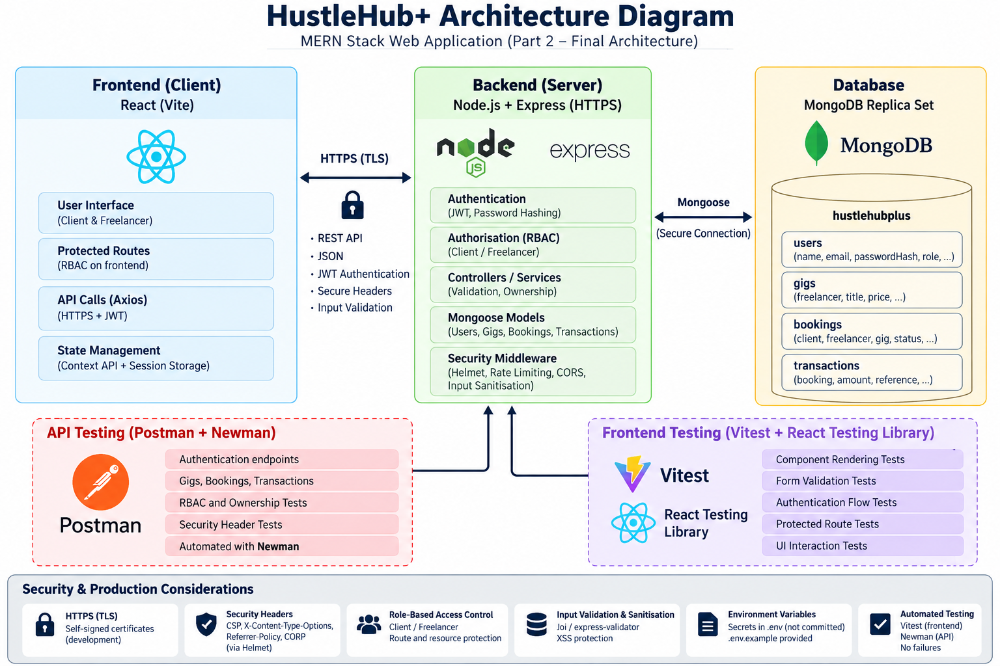

# HustleHub+

## Secure MERN Freelance Marketplace

HustleHub+ is a secure full-stack freelance marketplace developed as part of the INSY7314 Portfolio of Evidence.

The application allows Freelancers to advertise services or "Gigs", while Clients can browse available services and create bookings.

Each confirmed booking automatically creates an associated Transaction record. Freelancers can view bookings received for their Gigs and monitor income through a financial dashboard.

Security is a primary concern throughout the system because the application handles user credentials, booking information and financial data.

---

# Part 2 – Secure Stack

Part 2 extends the secure backend foundation created in Part 1 into a complete MERN stack application.

The system now includes:

- MongoDB database persistence.
- Express and Node.js REST API.
- React frontend built with Vite.
- Client and Freelancer authentication.
- JWT-based authentication.
- Role-Based Access Control.
- Gig creation and management.
- Client booking workflow.
- Automatic Transaction creation.
- Freelancer income tracking.
- Input validation and sanitisation.
- Rate limiting.
- HTTP security headers.
- Automated frontend testing.
- Automated API testing with Postman and Newman.

---

# Technology Stack

## Frontend

- React
- Vite
- React Router
- Axios
- Context API
- Session Storage
- Vitest
- React Testing Library

## Backend

- Node.js
- Express
- Mongoose
- JSON Web Tokens
- bcryptjs
- Zod
- Helmet
- CORS
- express-rate-limit
- sanitize-html

## Database

- MongoDB
- MongoDB single-node replica set
- Mongoose ODM

## Testing

- Vitest
- React Testing Library
- Postman
- Newman

---

# System Architecture

The HustleHub+ application follows a client-server MERN architecture.

```text
React + Vite Frontend
        │
        │ HTTPS
        │ Axios + JSON + JWT
        ▼
Node.js + Express API
        │
        ├── Authentication
        ├── JWT Validation
        ├── Role-Based Access Control
        ├── Input Validation
        ├── Input Sanitisation
        ├── Rate Limiting
        ├── Security Headers
        ├── Gig Ownership Protection
        ├── Booking Processing
        └── Transaction Processing
        │
        │ Mongoose
        ▼
MongoDB Replica Set
        │
        ├── users
        ├── gigs
        ├── bookings
        └── transactions
```

The final Part 2 architecture diagram is available at:

```text
docs/architecture/HustleHubPlus-Architecture.png
```



---

# User Roles

HustleHub+ currently supports two public application roles.

## Client

Clients can:

- Register and log in.
- Browse active Gigs.
- View Gig details.
- Create bookings.
- View their own bookings.
- View their booking details.
- View Transactions associated with their account.

Clients cannot:

- Create Freelancer Gigs.
- Modify Freelancer Gigs.
- Access Freelancer financial information.
- View bookings belonging to other users.

## Freelancer

Freelancers can:

- Register and log in.
- Browse the marketplace.
- Create Gigs.
- Edit their own Gigs.
- Activate and deactivate their own Gigs.
- Delete their own Gigs.
- View bookings received for their Gigs.
- View associated Transactions.
- View total income.
- View estimated tax information.

Freelancers cannot modify or delete another Freelancer's Gigs.

## Administrator Role

An ADMIN role exists within the role configuration for future expansion.

Public users are not permitted to register themselves as Administrators.

---

# Authentication

HustleHub+ uses JSON Web Tokens for authentication.

After successful login, the backend creates a signed JWT containing the authenticated user's identity.

Tokens include:

- User ID.
- User role.
- Issuer.
- Audience.
- Expiration.

The React frontend stores the authentication token in session storage and automatically attaches it to protected API requests using Axios.

```text
Authorization: Bearer <token>
```

Protected backend routes independently verify the JWT.

The backend also retrieves the current User record from MongoDB so authorization decisions use the current database role rather than relying only on the role stored inside an older token.

---

# Password Security

Passwords are never stored as plain text.

Passwords are hashed using bcrypt before being stored in MongoDB.

The configured bcrypt cost factor is:

```text
12
```

The stored User document contains a password hash rather than the original password.

Password hashes are excluded from normal database query results and are never intentionally returned through API responses.

---

# Role-Based Access Control

Role-Based Access Control is implemented on protected backend routes.

The two main application roles are:

```text
CLIENT
FREELANCER
```

RBAC is enforced on the server.

Examples include:

```text
CLIENT
→ May create Bookings
→ Cannot create Gigs
→ Cannot access Freelancer income

FREELANCER
→ May create and manage owned Gigs
→ Cannot create Client Bookings
→ May view income related to their account
```

Frontend route protection improves user experience, but backend authorization remains the actual security boundary.

---

# Resource Ownership

HustleHub+ implements ownership checks in addition to normal RBAC.

For example, being a Freelancer does not automatically allow a user to modify every Gig.

A Freelancer may only modify a Gig when:

```text
gig.freelancer === authenticatedUser.id
```

Similar ownership checks protect Booking and Transaction records.

Only the Client and Freelancer associated with a Booking may access that Booking.

This prevents authenticated users from accessing another user's resources simply by changing an ID in a URL.

---

# Gig Management

Freelancers can create marketplace Gigs containing:

- Title.
- Description.
- Category.
- Price.
- Delivery time.
- Active status.

Only the owning Freelancer may modify or delete a Gig.

Public users can browse active Gigs.

Inactive Gigs remain visible to the owning Freelancer but are hidden from the public marketplace and cannot be booked.

---

# Booking System

Only Clients may create Bookings.

The frontend submits:

```json
{
  "gigId": "<gig-id>",
  "requirements": "Client requirements"
}
```

The frontend does not control:

```text
Client ID
Freelancer ID
Gig price
Booking status
Payment status
Transaction status
```

These values are determined by the backend using trusted database information.

This prevents Clients from manipulating the booking price or Freelancer identity through a modified request.

---

# Simulated Payment Flow

No real payment provider or real banking information is used.

When a valid Client booking is created, HustleHub+ records the booking as:

```text
CONFIRMED
```

with:

```text
SIMULATED_CONFIRMED
```

payment status.

This allows the application to demonstrate secure Transaction and income functionality without collecting payment-card information.

---

# Transactions

Every new confirmed Booking automatically creates a corresponding Transaction.

Transaction information includes:

- Unique Transaction reference.
- Booking.
- Gig.
- Client.
- Freelancer.
- Gig title.
- Amount.
- Currency.
- Transaction type.
- Transaction status.
- Simulated payment method.
- Timestamp.

The Transaction amount is copied from the trusted Gig record rather than being supplied by the Client.

---

# MongoDB Transactions

Booking creation and Transaction creation are performed together using a MongoDB session.

The application uses:

```text
session.withTransaction()
```

This provides atomic behaviour.

The intended behaviour is:

```text
Booking succeeds
+
Transaction succeeds
=
Commit

OR

Booking fails
/
Transaction fails
=
Rollback
```

A local MongoDB replica set is therefore required.

---

# Freelancer Finance Dashboard

Freelancers can view:

- Total completed income.
- Number of completed Transactions.
- Estimated tax.
- Estimated income after tax.
- Transaction history.

The default simplified estimated tax rate is configured using:

```env
ESTIMATED_TAX_RATE=0.15
```

The tax value is included as an academic estimation feature only and is not intended to represent an official SARS tax calculation.

---

# Input Validation

HustleHub+ uses strict Zod validation on incoming API data.

Validation is applied to:

- Registration.
- Login.
- Gig creation.
- Gig updates.
- Booking creation.

Strict schemas reject unexpected properties.

For example, a Client cannot add:

```json
{
  "amount": 1,
  "status": "COMPLETED"
}
```

to a Booking request to manipulate the Transaction.

---

# Input Sanitisation

User-controlled text is sanitised before being stored.

Plain-text sanitisation is applied to fields such as:

- User names.
- Gig titles.
- Gig descriptions.
- Gig categories.
- Booking requirements.

HTML tags are removed so XSS-style input is not intentionally stored as executable markup.

React also escapes normal JSX text output.

---

# NoSQL Injection Protection

The API rejects unsafe MongoDB-style request keys.

Examples include:

```text
$ne
$gt
$where
```

and keys containing:

```text
.
```

Unsafe prototype-style keys are also rejected, including:

```text
__proto__
prototype
constructor
```

Combined with strict Zod schemas, this provides layered protection against malicious object structures and NoSQL injection attempts.

---

# HTTP Security

The Express application uses Helmet and additional security middleware.

Security controls include:

- HTTPS.
- Content Security Policy.
- X-Content-Type-Options.
- Referrer-Policy.
- Cross-Origin Resource Policy.
- CORS.
- Request-size limits.
- Authentication rate limiting.
- Booking/API rate limiting.
- Cache prevention for sensitive responses.

Express technology disclosure is disabled:

```text
X-Powered-By
```

is not exposed.

---

# Content Security Policy

The API applies a restrictive Content Security Policy including directives such as:

```text
default-src 'none'
base-uri 'none'
frame-ancestors 'none'
form-action 'none'
object-src 'none'
```

---

# Request Size Protection

JSON and URL-encoded request payloads are limited to approximately:

```text
10 KB
```

Oversized requests return:

```text
413 Payload Too Large
```

---

# Content-Type Enforcement

API write operations require:

```text
Content-Type: application/json
```

Unsupported request formats return:

```text
415 Unsupported Media Type
```

---

# Rate Limiting

Rate limiting is implemented to reduce abuse.

Authentication routes are protected against repeated login attempts.

Booking/API endpoints also apply request-rate controls.

Rate-limit tests are kept separate from the normal Newman collection so automated test execution does not intentionally lock development endpoints.

---

# Error Handling

The backend provides controlled responses for application errors.

Typical responses include:

```text
200 OK
201 Created
400 Bad Request
401 Unauthorized
403 Forbidden
404 Not Found
409 Conflict
413 Payload Too Large
415 Unsupported Media Type
429 Too Many Requests
500 Internal Server Error
```

Production-facing responses do not intentionally expose:

- Stack traces.
- JWT secrets.
- MongoDB connection strings.
- Password hashes.
- Internal configuration.

---

# Environment Variables

Sensitive and environment-specific configuration is stored using environment variables.

The `.env` files are excluded from Git.

Example files are provided instead.

## Backend `.env.example`

```env
PORT=3000
NODE_ENV=development

JWT_SECRET=replace-with-a-secure-random-secret
JWT_EXPIRES_IN=1h

SSL_KEY_PATH=certs/localhost-key.pem
SSL_CERT_PATH=certs/localhost.pem

CLIENT_ORIGIN=https://localhost:5173

MONGODB_URI=mongodb://127.0.0.1:27017/hustlehubplus?replicaSet=rs0

ESTIMATED_TAX_RATE=0.15
```

## Frontend `.env.example`

```env
VITE_API_BASE_URL=https://localhost:3000/api
```

---

# Installation

## Requirements

Before running HustleHub+, install:

- Node.js.
- npm.
- MongoDB Community Server.
- MongoDB Shell.
- mkcert.
- Git.

---

# 1. Clone the Repository

```bash
git clone <YOUR-GITHUB-REPOSITORY-URL>
cd HustleHubPlus
```

---

# 2. Configure MongoDB

HustleHub+ uses MongoDB Transactions and therefore requires a replica set.

Configure the MongoDB server with:

```yaml
replication:
  replSetName: rs0
```

Restart MongoDB.

Open MongoDB Shell:

```bash
mongosh
```

Initialise the replica set:

```javascript
rs.initiate()
```

Confirm that the node becomes:

```text
PRIMARY
```

The application uses:

```text
mongodb://127.0.0.1:27017/hustlehubplus?replicaSet=rs0
```

---

# 3. Configure Backend HTTPS Certificates

Create the certificate directory:

```bash
cd backend
mkdir certs
```

Install the local mkcert Certificate Authority:

```bash
mkcert -install
```

Generate certificates:

```bash
mkcert -key-file certs/localhost-key.pem -cert-file certs/localhost.pem localhost 127.0.0.1 ::1
```

The certificate files are intentionally excluded from Git.

---

# 4. Configure the Backend

From:

```text
backend/
```

install packages:

```bash
npm install
```

Copy:

```text
.env.example
```

to:

```text
.env
```

Then replace the JWT placeholder with a strong random secret.

Example:

```env
JWT_SECRET=<secure-random-secret>
```

Do not commit the `.env` file.

---

# 5. Run the Backend

From:

```text
backend/
```

run:

```bash
npm run dev
```

The API will be available at:

```text
https://localhost:3000
```

Health endpoint:

```text
https://localhost:3000/api/health
```

---

# 6. Configure the Frontend

Open another terminal:

```bash
cd frontend
npm install
```

Copy:

```text
.env.example
```

to:

```text
.env
```

The default API URL is:

```env
VITE_API_BASE_URL=https://localhost:3000/api
```

---

# 7. Run the Frontend

```bash
npm run dev
```

Open:

```text
https://localhost:5173
```

---

# Frontend Automated Testing

Frontend automated tests use:

- Vitest.
- React Testing Library.
- Testing Library User Event.
- Jest DOM.
- jsdom.

Run:

```bash
cd frontend
npm test
```

The automated frontend suite verifies component rendering and user interaction including:

- Gig-card rendering.
- Gig-form interaction.
- Marketplace rendering.
- Marketplace search.
- Login.
- Authentication errors.
- Registration validation.
- Role-protected routing.

Watch mode:

```bash
npm run test:watch
```

---

# Frontend Quality Checks

Run ESLint:

```bash
npm run lint
```

Create a production build:

```bash
npm run build
```

A successful build creates:

```text
frontend/dist/
```

The `dist` directory is ignored by Git.

---

# Postman API Testing

The Part 2 API collection is stored at:

```text
postman/HustleHubPlus-Part2.postman_collection.json
```

The collection tests:

- API health.
- Registration.
- Login.
- JWT authentication.
- RBAC.
- Gig CRUD.
- Gig ownership.
- Booking creation.
- Booking isolation.
- Transaction creation.
- Transaction isolation.
- Freelancer income.
- Estimated tax.
- NoSQL injection.
- Mass assignment.
- XSS-style input.
- Prototype-style input.
- Invalid JWT handling.
- Request-size restrictions.
- Content-Type enforcement.
- Security headers.
- CORS.

The collection generates unique test users for every complete run.

---

# Newman Automated API Testing

Newman is installed as a backend development dependency.

Ensure the backend and MongoDB are running.

From:

```text
backend/
```

execute:

```bash
npm run test:api
```

The command runs the complete Part 2 Postman collection from the terminal.

The local Newman command uses:

```text
--insecure
```

because the development API uses a locally generated HTTPS certificate.

This is for local development testing only and does not disable HTTPS in the application.

A successful API test run should finish with:

```text
0 failures
```

---

# API Test Evidence

Testing evidence may be stored under:

```text
docs/testing/
docs/screenshots/part2/
```

Examples include:

```text
Frontend Vitest results
Newman execution results
Application screenshots
Security testing evidence
```

---

# Main API Endpoints

## Authentication

```text
POST /api/auth/register
POST /api/auth/login
GET  /api/auth/me
```

## Gigs

```text
GET    /api/gigs
GET    /api/gigs/mine
GET    /api/gigs/:id
POST   /api/gigs
PUT    /api/gigs/:id
DELETE /api/gigs/:id
```

## Bookings

```text
POST /api/bookings
GET  /api/bookings/client
GET  /api/bookings/freelancer
GET  /api/bookings/:id
```

## Transactions

```text
GET /api/transactions/client
GET /api/transactions/freelancer
GET /api/transactions/income
GET /api/transactions/:id
```

---

# Database Collections

## users

Stores:

```text
name
email
passwordHash
role
timestamps
```

## gigs

Stores:

```text
freelancer
title
description
category
price
deliveryDays
isActive
timestamps
```

## bookings

Stores:

```text
gig
client
freelancer
gigTitle
amount
requirements
status
paymentStatus
timestamps
```

## transactions

Stores:

```text
transactionReference
booking
gig
client
freelancer
gigTitle
amount
currency
type
status
paymentMethod
timestamps
```

---

# Secure Development Summary

HustleHub+ applies defence-in-depth rather than relying on a single security mechanism.

The application combines:

```text
HTTPS
+
Secure password hashing
+
JWT authentication
+
Database-backed authorization
+
Role-Based Access Control
+
Resource ownership
+
Strict input validation
+
Input sanitisation
+
NoSQL injection protection
+
Mass-assignment protection
+
Rate limiting
+
Security headers
+
Request-size controls
+
Controlled error handling
+
Automated frontend tests
+
Automated API security tests
```

This approach protects the application's authentication, marketplace, booking, Transaction and income workflows across multiple layers.

---

# Part 2 Testing Summary

The completed Part 2 implementation has been tested using:

```text
Manual end-to-end testing
Vitest
React Testing Library
Postman
Newman
ESLint
Vite production build
```

The final regression process verifies:

```text
Registration
Login
JWT authentication
Marketplace browsing
Gig management
Booking creation
Automatic Transaction creation
Freelancer income
RBAC
Resource ownership
Input validation
Input sanitisation
Security headers
Frontend tests
API tests
Production build
```

---

# Repository

GitHub:

```text
https://github.com/st10091902/HustleHubPlus.git
```

---

# Demonstration Video

Part 2 demonstration:

```text
Unable to upload to YouTube. Video is uploaded to POE Part 2 ARC submission link.
```

---

# Disclaimer

HustleHub+ is an academic demonstration application.

The payment flow is simulated and no real payment information is processed.

The estimated tax functionality is a simplified academic calculation and should not be interpreted as official tax or financial advice.